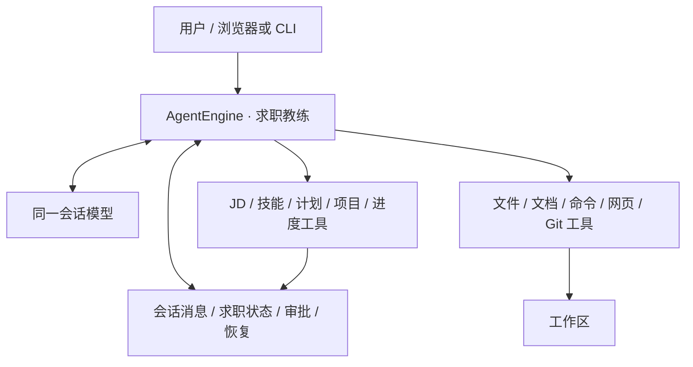
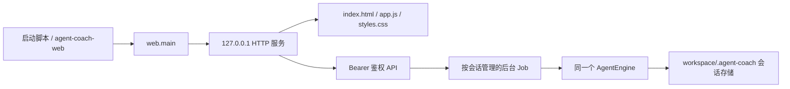

# 校招雷达：单一求职教练 Agent

校招雷达的产品入口只有一个持续的求职教练。用户从 JD、简历或已有技能开始，后续追问、材料、工具结果、审批和实践证据都进入同一个会话上下文。产品不要求用户选择通用 Agent、安装求职模块或按固定按钮逐步调用模型。

## 模块职责

| 模块 | 责任 |
| --- | --- |
| `cli.py` / `bootstrap.py` | 启动入口、配置读取、单一 Agent 组装 |
| `engine.py` | 同一会话的模型/工具循环、上下文持久化、审批暂停与继续 |
| `contracts.py` | 会话消息、图片块、工具定义、审批和结果协议 |
| `store.py` | 工作区绑定、会话存储、互斥锁和原子写入 |
| `tools.py` | 工作区工具以及 prepare/execute 审批分离 |
| `job_radar.py` | 求职领域状态和工具：JD、技能证据、计划、项目、进度 |
| `legacy/core/llm` | OpenAI 兼容和 Anthropic 适配器、`agent/default` 模型配置 |
| `legacy/tools` / `legacy/domain` | 文档解析、岗位和求职领域算法 |
| `web.py` | localhost 静态资源、Bearer 鉴权、上传、会话和后台 job API |

`job_radar.py` 的工具直接注册到产品 Agent 的工具注册表。它们接收当前会话和工作区上下文，负责校验结构化结果、状态变更或项目检索，不再调用第二个模型来生成中间工件。所有领域工具和通用工作区工具都共享同一套路径校验、审批和恢复规则。

## 同一 Agent 的多轮循环

每次用户发送消息时，`AgentEngine.run()` 会在会话锁内恢复工作流和未完成执行，追加一条用户消息，然后进入循环：

1. 使用同一个会话消息列表调用模型，并携带当前可用工具定义。
2. 保存模型文本和工具调用；只读工具直接执行，带外部副作用的工具先保存精确审批 ID、预览和后续队列。
3. 把工具结果追加到同一会话上下文，再调用同一个 Agent 模型继续处理。
4. 直到模型完成回复、需要用户审批、执行结果未知、遇到可恢复错误或达到循环步数上限。

模型负责理解岗位、补问材料、比较技能差距和选择下一步；工具负责真实读取、写入、搜索、命令执行和结构化状态更新。模型上下文包含当前项目的完整兼容进度，以及 `project_history` 的有界项目状态摘要；历史证据仍在会话状态中供界面查看。工具实现不得为了完成领域动作再启动 LLM 请求，`ToolContext.router` 只保留兼容接口，求职工具不会通过它发起嵌套模型调用。

## 模型配置

真实模型配置使用 `config/providers.yaml`。`providers` 定义端点和密钥环境变量，`tasks` 只保留 `default` 和 `agent` 两个入口，并将它们指向同一条 Agent 模型链。解析 JD、建立技能档案、生成计划、项目排序和后续对话都使用当前会话模型；不存在独立的 vision、parsing、planning 或 interview 模型任务。

模型必须支持工具调用；如果会话包含图片材料，当前会话使用的同一个模型还必须支持视觉输入。纯文本求职对话只要求工具调用能力。配置只保存端点、模型名和环境变量名，密钥从环境读取。离线 `--demo` 只用于验证界面和审批路径，不代表真实模型调用。

## 浏览器工作台

浏览器工作台和 CLI 使用同一个 `build_engine`、会话存储、工具注册表和模型路由。`run-web.py` 与安装后的 `agent-coach-web` 都调用 `agent_coach.web.main`，由 `WebService` 创建服务并把长操作放进按会话管理的后台 job：

服务默认绑定 `127.0.0.1:8765`，启动时输出带 `#token=...` 的 URL 并按需打开浏览器。前端从 fragment 读取令牌，存入当前标签页的 `sessionStorage` 后移除地址栏 fragment；API 请求使用 `Authorization: Bearer ...`。请求目标、Host 和 Origin 会在路由前检查，服务拒绝代理式 absolute-form URL，只允许 loopback 与当前端口。静态层只提供 `index.html`、`app.js` 和 `styles.css`，不会把工作区当作静态目录暴露。

受保护的工作区 API 提供会话列表和快照、消息提交、审批、继续、人工确认、文件列表/预览、上传和 job 轮询。消息请求包含当前会话文本；图片上传成功后，前端在同一条消息的 `attachments` 字段中提交工作区相对路径。服务把路径交给 `AgentEngine.run(..., attachments=...)`，由引擎校验路径、大小和媒体类型并生成 `ImageBlock`，图片和文字随后由同一模型处理。图片只接受 PNG、JPEG、GIF、WebP，单张上限 10 MiB、单轮总量上限 20 MiB；普通文档仍作为工作区文件由 Agent 使用文件工具读取。

JSON 请求、文本、文件读取、上传和静态资源都有大小上限；文件访问复用 `tools.resolve_path` 的工作区边界、敏感路径和符号链接检查。后台 job 只负责 HTTP 层的异步等待和状态查询，不改变内核的工具顺序、审批和恢复语义。

## 求职状态

求职状态和历史保存在会话的求职状态区，包含：

- 当前 JD 及来源；
- 已有技能、事实证据和待补充问题；
- 基于当前 JD/技能的学习计划和差距；
- 候选项目、选中项目及选择理由；
- 当前项目的实践进度，以及按稳定项目身份累积保存的 `project_history`（每个项目自己的进度、证据和审批状态）。切换候选或刷新搜索不会覆盖历史；更新 JD、技能档案或计划时只清空失效的当前派生视图。

更新 JD 或技能资料会使下游计划、项目和进度失效，旧结果留在历史中供会话追溯。右侧工作台只展示这些求职资料和工作区文件，状态概览由 Agent 在对话中返回并可根据新材料修订。

## 图片、审批和恢复

浏览器上传接口先把文件写入当前工作区的 `uploads/` 子目录，并返回相对路径。对于图片，前端把该路径放进当前消息的 `attachments` 数组；引擎只接受工作区内、大小受限且媒体类型受支持的普通文件，读取后以 `ImageBlock` 保存在会话消息中。该流程不会为图片额外选择模型或发起一次独立请求。

写文件、执行命令和记录需要用户确认的实践结果使用 prepare/execute 审批分离。审批预览只展示经过清理的参数和差异，批准时必须匹配当前会话的完整 ID。执行标记写入后进程退出时，恢复路径会把结果标为未知并禁止自动重放；用户核实并提交备注后才能继续。

## 边界

这是一个本地求职 Agent 基础版本，提供 localhost 浏览器工作台；原生桌面可执行程序仍未构建。目前没有 MCP 客户端、多 Agent 调度、自动上下文压缩或操作系统级沙箱。批准的命令使用当前用户权限，能够产生工作区外的副作用；文件工具的路径约束不等于命令沙箱。网页访问进行公网地址及跳转检查，但仍存在 DNS 解析与连接之间的变化窗口。命令超时不保证终止全部孙进程。
